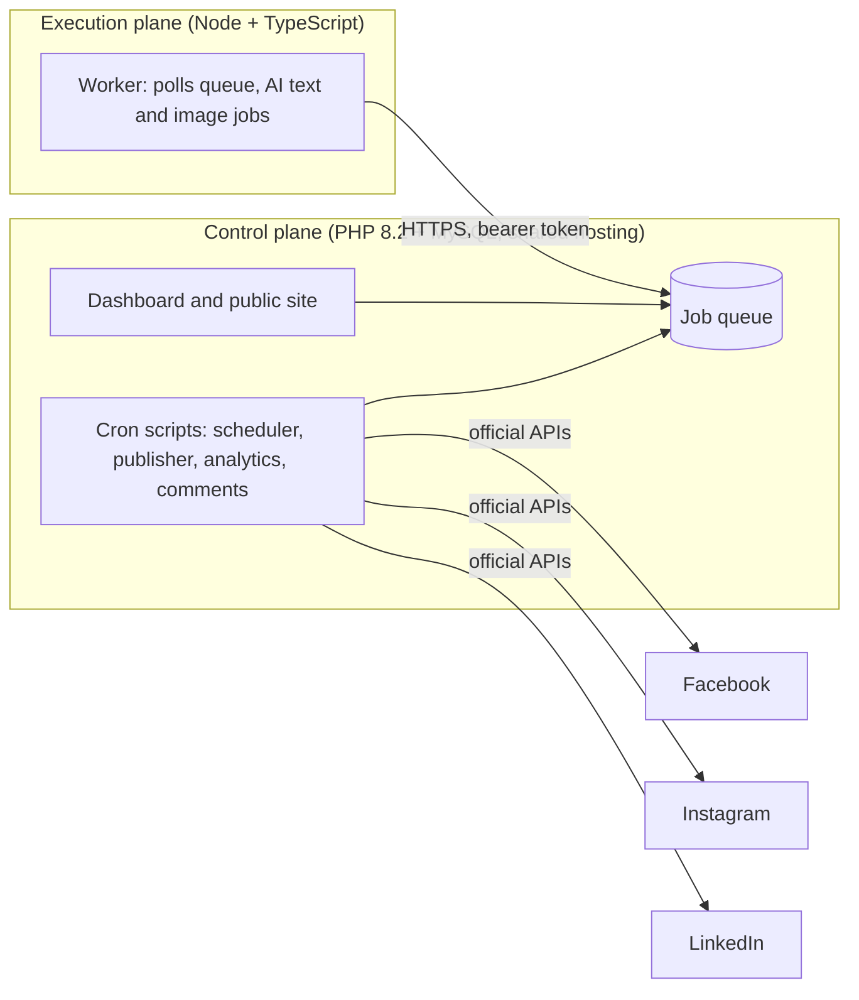

# Prism Pilot: AI Social Media Manager

**Live product:** https://social.websiteprism.com · Built by [Usama Afzal](https://usama.websiteprism.com) at [Website Prism](https://websiteprism.com)

Prism Pilot learns a business from its website, writes captions in the brand's voice, creates a picture for every post and schedules it on **Facebook, Instagram and LinkedIn**. It is a multi-business product with its own sign-up, plans and admin back-office.

> This repository is a **case study**. The product source code is private and is not published here.

## What it does

| Area | What the customer gets |
|---|---|
| Brand knowledge | Reads the business's website, products, prices and rules, and keeps them as editable knowledge documents |
| Content engine | Captions in the brand's voice, weighted content pillars, posting windows per time zone |
| Image engine | A picture for every post, branded or built from the customer's own product photos; Instagram carousels |
| Publishing | Scheduler publishes through the official platform APIs, with idempotent publish jobs so a post never goes out twice |
| Comments | Suggested replies to new comments. **Nothing is ever posted without the owner's approval** |
| Growth | Daily list of accounts to follow and posts worth commenting on |
| Analytics | Plain-English reports on what worked, winners and losers, best posting times, A/B experiments |
| Automation controls | Global PAUSE ALL / RESUME ALL, per-brand, per-platform and per-account switches, full activity log |
| Plans | Starter, Growth and Agency plans with a 7-day free trial (see the live pricing page) |

## Architecture

Design choices worth noting:

- **Runs on ordinary shared hosting.** Pure PHP and cURL, no framework and zero Composer dependencies, so the running cost stays close to nothing.
- **Publishing never depends on a PC.** Prepared posts publish from the server; heavy AI work is queued and picked up by a separate worker, so one failing job, account or image never stops the rest.
- **Multi-tenant from the data model up.** Every brand has an owner; every query is scoped to the signed-in customer; platform admins are the only ones who see across customers.
- **Security by default.** Tokens encrypted at rest with AES-256-GCM, prepared statements only, CSRF protection on every state-changing request, HttpOnly SameSite cookies, login lock-out after repeated failures, strict output escaping, no inline scripts.
- **Everything is visible.** Each automated action appears in an audit log and the dashboard, so the owner can always see and override what the AI did.

## By the numbers (from the codebase)

- 26 database migrations and 15 scheduled cron scripts
- 18 test suites covering services, modules and the worker API
- Modules: Auth, Brands, Automation, Content, Calendar, Media, Jobs, AI, Analytics, Comments, Commands, Experiments, Billing, Admin, public marketing site

## Tech

`PHP 8.2` · `MySQL` · `Node.js` · `TypeScript` · `REST worker API` · `Facebook, Instagram and LinkedIn APIs` · `OAuth 2.0` · `JSON-LD SEO` · `cron`

## Want something like this?

I build custom AI automation, SaaS products and integrations for businesses.

- Portfolio: https://usama.websiteprism.com
- Contact: https://usama.websiteprism.com/contact
- Hire me on Fiverr: https://www.fiverr.com/shopify_xpert01

© 2026 Usama Afzall (Website Prism). All rights reserved.
